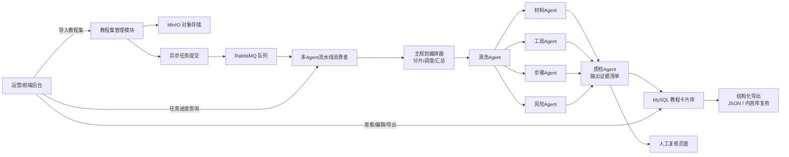

# 01 - 引言与项目概览

> 本文档包含：术语约定、项目背景、定位、目标用户、核心问题、业务全景、技术栈选型。
>
> 本文为**概览章**（1.1–1.7）。完整文档导航见 [README.md](./README.md)。

---

## 1.1 术语与枚举约定（全文统一口径）

| 类别 | 统一写法 | 说明 |
| --- | --- | --- |
| 任务状态 | `pending → running → succeeded / failed → dead` | 过去分词，与 SQL 枚举一致 |
| 优先级 | `P0 / P1 / P2` | 对应 0/1/2，存 `priority TINYINT` |
| 卡片生命周期 status | `draft / published / archived` | 只表示卡片本身的生命周期 |
| 人工复核状态 review_status | `auto_passed / pending_review / reviewed / rejected` | 表示人工审核环节的状态 |
| 角色 | `admin / editor / viewer` | 全文统一，中文注释对齐 |
| 材料/物料 | 统一叫"材料" | Agent 名 `material_agent` |
| 系统称呼 | "平台" | 标题保留"工作站"，正文统一"平台" |
| 仓库名 | `diy-tutorial-agent` | 前后端分 `server/` `web/` 目录 |

***

## 1.2 项目背景

互联网上 UGC 手工教程（DIY）内容爆炸式增长，手工社区、内容平台上大量教程是作者随手写的**自由长文本**：材料、工具、操作步骤混在一大段叙事里，夹杂闲聊、广告、感叹语。

现状与问题：

| 问题 | 现状 | 后果 |
| --- | --- | --- |
| 机器读不懂内容结构 | 教程是自由文本，只有全文检索能力 | 用户无法按难度/工具/材料精细化筛选 |
| 内容整理靠人工 | 运营逐篇阅读、手动拆分材料工具步骤 | 人工成本高、周期长、标准不统一 |
| 单轮 LLM 抽取不稳 | 文本噪声多，一次提取多种实体易互相干扰 | 材料漏提、步骤顺序错乱、质量不可控 |
| 安全风险难发现 | 高温、尖锐刀具等风险散落在长文里 | 用户实操安全隐患，平台审核难覆盖 |
| 内容无法复用 | 非结构化文本无法被推荐/卡片/小程序复用 | UGC 内容价值无法充分释放 |

因此需要一个**轻量化、可私有化部署**的多 Agent 教程结构化平台，批量把非结构化 UGC 教程转成标准化教程卡片，同时后端架构要经得起真实业务考验（异步、容错、可观测、权限）。

***

## 1.3 项目简介与定位

### 1.3.1 业务简介

运营批量导入公开 DIY 教程数据集 → 文件存入 MinIO → 提交异步任务到 RabbitMQ → 后台多 Agent 流水线消费：

1. **主规划 Agent**：拆分子任务、调度流水线、汇总结果；
2. **文本清洗 Agent**：剥离广告、闲聊、冗余语句，输出清洗后文本 + 被删片段记录；
3. **材料提取 Agent**：提取材料、耗材清单（含规格、用量）；
4. **工具提取 Agent**：提取所需工具清单；
5. **步骤拆解 Agent**：把连续长文拆成有序分步操作；
6. **难度与风险评估 Agent**：评估难度等级，识别安全风险点；
7. **质检 Agent**：校验步骤顺序、清单完整性，输出证据清单（不直接给分）。

处理完成后：高置信教程卡片直接入库，低置信样本进入人工复核页面；支持导出结构化 JSON，供内容库复用。

### 1.3.2 项目定位

- **场景是载体，核心是通用 UGC 内容结构化流水线**：DIY 教程只是验证场景，替换 Prompt 与字段定义，可迁移到菜谱、科普、线上课程等其他 UGC 文本结构化场景；
- **AI 是不稳定外部依赖，不是项目主体**：核心考察点是 Agent 流水线工程能力 + 后端工程能力；
- **只结构化原文，不校验教程正确性**：平台抽取的是原文里写了什么，不判断教程实操是否安全可行（边界清晰）。

### 1.3.3 一句话总结

> 本平台是面向 UGC 非规范长文本的多 Agent 结构化流水线系统，通过异步任务编排与多 Agent 流水线（清洗→材料/工具/步骤/风险评估→质检），批量把自由文本教程转化为标准化教程卡片；用置信度分流 + 人工复核闭环解决 LLM 多实体抽取被噪声干扰、信息丢失、质量不可控的问题，支撑精细化检索与内容复用。

***

## 1.4 目标用户（给谁用）

| 角色 | 人群 | 权限 |
| --- | --- | --- |
| editor（编辑） | 内容运营、编辑 | 导入教程集、提交任务、查看/编辑教程卡片（导出仅 admin，见 4.2） |
| admin（管理员） | 内容平台负责人 | 账号角色管理、Agent 配置、项目统计 |
| viewer（只读） | 外部协作者 | 仅查看，不可编辑导出 |

> 权限模型采用 **RBAC（用户-角色-资源）**，数据按教程集隔离。

***

## 1.5 解决的核心问题

### 1.5.1 解决 UGC 长文本下单轮 LLM 多实体抽取的工程痛点

- 原来：长文噪声多，一次提取材料+工具+步骤互相干扰，漏项、错序、JSON 不稳；
- 现在：先净化再解耦，材料/工具/步骤/风险各自独立 Agent，质检兜底校验。

### 1.5.2 解决 UGC 内容无法精细化检索与复用的问题

- 原来：自由文本只能全文检索；
- 现在：结构化后支持按难度、工具、材料筛选（维度表支撑索引），可被推荐平台、内容卡片复用。

### 1.5.3 解决内容整理人工成本高的问题

- 原来：运营逐篇手动拆分；
- 现在：Agent 预拆解 + 置信度分流，人工只复核低置信条目。

### 1.5.4 解决批量任务工程化落地的问题

- 原来：脚本同步处理，失败无重试、无进度；
- 现在：MQ 异步分片、幂等、死信、重试、任务进度可视化。

***

## 1.6 业务全景与核心功能

> 材料/工具/步骤/风险四路是**并行分支**，不是串行链——8.1.1 的单条耗时按 `max(四路)` 而非求和计算。图上分行画是为了看清数据流向。

### 1.6.1 功能清单

| 模块 | 功能 |
| --- | --- |
| 账号权限 | 注册登录、JWT（access + refresh）、RBAC 角色权限、用户管理 |
| 教程集管理 | 上传/导入教程文件、版本管理、来源元数据、样本统计 |
| 异步任务 | MQ 队列、任务状态机、Agent 子任务独立重试、幂等、死信、分布式锁、优先级、outbox 投递补偿 |
| 多Agent流水线 | 主规划、清洗、材料、工具、步骤、风险评估、质检（独立可配置开关） |
| 教程卡片管理 | 结构化卡片列表、详情、编辑复核、低置信标记、版本化 |
| 质检与置信度 | 字段校验、步骤时序校验、一致性校验、多维度加权打分（代码算分）、阈值分流 |
| 数据导出 | 标准 JSON/CSV 导出、增量导出 |
| 统计报表 | 结构化成功率、置信度分布、复核率、Agent 调用量、token 消耗 |
| 可观测 | 结构化日志（traceId 跨 MQ 传递）、Prometheus 指标、Grafana 大盘 |

***

## 1.7 技术栈选型及理由

| 层 | 选型 | 理由 |
| --- | --- | --- |
| 语言/框架 | Go + Gin | 你正在学 Go；Go 并发模型适合 MQ 消费者与 Agent 编排 |
| ORM | GORM | Go 主流 ORM，事务、软删除、钩子开箱即用 |
| 业务库 | MySQL 8.0 | 关系型主库，JSON 字段 + 多值索引，通用性最强 |
| 缓存 | Redis | 缓存、限流计数、分布式锁、JWT refresh 白名单、任务幂等标记 |
| 消息队列 | RabbitMQ | 持久化、重试、死信、优先级、多消费者，生产级异步链路 |
| 对象存储 | MinIO | 本地可跑、S3 协议兼容，存放原始教程文件 |
| 向量库 | 不需要（MVP） | 本场景无需 RAG，扩展阶段可选做相似教程推荐 |
| LLM | 第三方 LLM API（DeepSeek/豆包） | 纯文本抽取，不本地部署模型，成本低 |
| 可观测 | Zap + Prometheus + Grafana | 结构化日志 + 指标埋点 + 可视化大盘 |
| 测试 | Go test + 接口集成测试 | 单元测试 + 集成测试 + 简单压测 |
| 部署 | Docker + Docker Compose | 一键拉起 Go/MySQL/Redis/RabbitMQ/MinIO |
| 前端 | React（管理后台） | 发挥 10 年前端优势，完成全栈闭环 |

**明确不选的方案（以及为什么）**：

| 候选 | 不选的理由 | 什么情况下才该选 |
| --- | --- | --- |
| Kubernetes | 单机 compose 已满足 5000 条/天，K8s 只会增加运维面 | 多租户、需要弹性伸缩到 10 台以上 |
| gRPC | 只有一个前端消费者，HTTP/JSON 调试成本更低 | 内部服务数 > 5、需要强类型契约 |
| LangChain / 编排框架 | 流水线是固定 DAG，框架的抽象反而挡住状态与重试控制 | 需要动态规划、工具调用分支 |
| 向量库 / RAG | 场景是"抽取"不是"检索"，MVP 无相似推荐需求 | 做相似教程推荐、跨教程问答时 |
| 本地部署大模型 | 显存成本高、与"轻量可私有化"的定位冲突 | 数据不允许出内网时 |
| 分库分表 | 单表最大约 72 万行（`agent_items`，10 万教程口径，见 3.4.5），且已按月归档 | 单表 > 2000 万或写入 > 5000 TPS |

> 技术选型原则：**能用成熟组件绝不重复造轮子**，把精力留给 Agent 流水线与工程难点。
> 同时**不为不存在的规模做设计**——每条"不选"都写清触发条件，比堆技术栈更能说明判断力。

***

