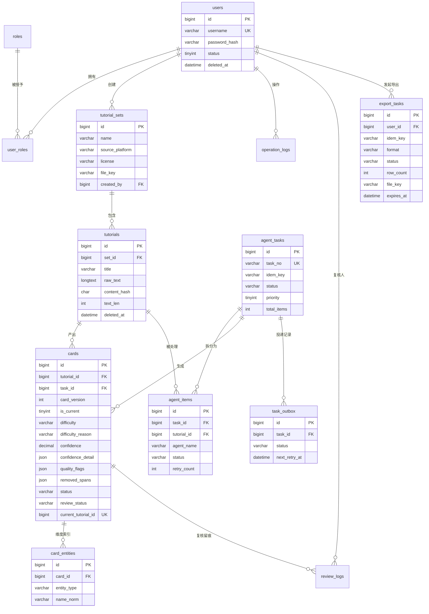

# 03 - 数据设计

> 本文档包含：表设计概览、ER 关系、完整建表 SQL、索引设计。

---

## 3.1 数据库设计（表清单）

> 完整建表 SQL 见 3.2，ER 关系见 3.3，约束与取舍说明见 3.4。

| 表 | 说明 | 关键字段 |
| --- | --- | --- |
| users | 用户 | id, username, password_hash, email, status, created_at |
| roles | 角色 | id, name, code（admin/editor/viewer）, description |
| user_roles | 用户-角色关联（多对多） | user_id, role_id |
| tutorial_sets | 教程集 | id, name, source_platform, version, file_key, sample_count, source_url, created_by |
| tutorials | 教程原始记录 | id, set_id, title, raw_text, source_url, created_at |
| cards | 结构化教程卡片 | id, tutorial_id, task_id, card_version, is_current, materials_json, tools_json, steps_json, risk_json, difficulty, difficulty_reason, confidence, confidence_detail, quality_flags, removed_spans, status, review_status |
| card_entities | 材料/工具维度表（筛选用） | id, card_id, entity_type, name, name_norm, spec |
| agent_tasks | Agent 任务主表 | id, task_no, idem_key, set_id, user_id, task_type, status, priority, total_items, success_items, failed_items, review_items, trace_id |
| agent_items | Agent 子任务表 | id, task_id, tutorial_id, agent_name, status, retry_count, token_in, token_out, result_ref, error_msg |
| task_outbox | 本地消息表（MQ 投递补偿） | id, task_id, payload, status, retry_count, next_retry_at |
| agent_configs | Agent 配置表 | id, agent_name, model, temperature, max_tokens, prompt_template, enabled |
| review_logs | 人工复核记录 | id, card_id, user_id, original_json, modified_json, reason |
| operation_logs | 操作审计 | id, user_id, action, target_type, target_id, ip, detail |
| export_tasks | 导出任务（4.3.5/4.3.6 的状态与票据落点） | id, user_id, idem_key, format, filter_json, fields_json, status, row_count, file_key, expires_at |

**设计要点**（本章唯一一份，3.2 不再重复）：

1. **`agent_tasks.idem_key`** = 客户端幂等键，`(user_id, idem_key)` 唯一约束，防用户手抖重复提交；
2. **`task_outbox`** = 本地消息表，"写 MySQL + 写 outbox"同一事务，后台协程扫 outbox 投 MQ，解决"写库成功但 MQ 投递失败"的窗口；
3. **`agent_items`** = `(task_id, tutorial_id, agent_name)` 三元组唯一，支持"第 37 条教程的步骤 Agent 失败，单独重试"；
4. **`cards`** = `(tutorial_id, card_version)` 唯一，支持重跑不覆盖；`is_current` 的唯一性由生成列 `uk_current_card` 在数据库层保证；
5. **`card_entities`** = 维度表，`(card_id, entity_type, name_norm)` 唯一 + `(entity_type, name_norm)` 索引支撑筛选；JSON 列只做展示快照；
6. **`agent_configs`** = 模型/温度/max_tokens 可运营调；**Prompt 正文不入库**，库里只存 `prompt_key` 版本标识，消除"改文件不生效、改 SQL 才生效"的双源问题；
7. **`tutorial_sets.license`** = 数据许可随集落库，导出与前端展示时随卡片带出，是合规追溯的锚点（见 5.6）；
8. **软删** = `users / tutorial_sets / tutorials / cards` 四张表统一带 `deleted_at`，级联规则见 3.4.2；
9. **`difficulty` 拆两列** = `difficulty`（枚举，供 `idx_difficulty` 筛选）+ `difficulty_reason`（理由，供展示与复核比对）。Card Schema 里的 `difficulty:{level,reason}` 是两个字段的**拼装视图**，不单独存 JSON——理由列永远有落点，不会出现"复核员改了理由、落库即丢"。

10. **`export_tasks`** = 导出是有副作用的异步写操作（4.3.5），状态/行数/票据过期时间必须有落点，否则 `GET /exports/{id}` 无数据可返；`(user_id, idem_key)` 唯一，与 `agent_tasks` 共用同一套幂等语义（4.6）；
11. **`cards.status`** = 卡片生命周期（`draft → published → archived`），**流水线只产 `draft`**，`published`/`archived` 只能由人工动作写入，流转规则与执行者的唯一权威见 **5.7**。

***

## 3.2 MySQL 建表 SQL

> 以下为完整建表 SQL，可直接作为 `scripts/init.sql`。

```sql
-- =============================================================
-- DIY 手工教程结构化拆解 Agent 工作站 数据库初始化脚本
-- =============================================================

CREATE DATABASE IF NOT EXISTS diy_tutorial_agent DEFAULT CHARACTER SET utf8mb4 COLLATE utf8mb4_unicode_ci;
USE diy_tutorial_agent;

-- 1. 用户表
CREATE TABLE `users` (
  `id`            BIGINT UNSIGNED NOT NULL AUTO_INCREMENT COMMENT '用户ID',
  `username`      VARCHAR(64)     NOT NULL COMMENT '用户名（唯一）',
  `password_hash` VARCHAR(255)    NOT NULL COMMENT 'bcrypt 密码哈希',
  `email`         VARCHAR(128)    DEFAULT NULL COMMENT '邮箱',
  `status`        TINYINT         NOT NULL DEFAULT 1 COMMENT '状态：1启用 0禁用',
  `created_at`    DATETIME        NOT NULL DEFAULT CURRENT_TIMESTAMP,
  `updated_at`    DATETIME        NOT NULL DEFAULT CURRENT_TIMESTAMP ON UPDATE CURRENT_TIMESTAMP,
  `deleted_at`    DATETIME        DEFAULT NULL,
  PRIMARY KEY (`id`),
  UNIQUE KEY `uk_username` (`username`)
) ENGINE=InnoDB COMMENT='用户表';

-- 2. 角色表
CREATE TABLE `roles` (
  `id`          BIGINT UNSIGNED NOT NULL AUTO_INCREMENT,
  `name`        VARCHAR(64)     NOT NULL COMMENT '角色名称',
  `code`        VARCHAR(32)     NOT NULL COMMENT '角色标识：admin/editor/viewer',
  `description` VARCHAR(255)    DEFAULT NULL,
  `created_at`  DATETIME        NOT NULL DEFAULT CURRENT_TIMESTAMP,
  PRIMARY KEY (`id`),
  UNIQUE KEY `uk_code` (`code`)
) ENGINE=InnoDB COMMENT='角色表';

-- 3. 用户-角色关联表
CREATE TABLE `user_roles` (
  `id`         BIGINT UNSIGNED NOT NULL AUTO_INCREMENT,
  `user_id`    BIGINT UNSIGNED NOT NULL,
  `role_id`    BIGINT UNSIGNED NOT NULL,
  `created_at` DATETIME        NOT NULL DEFAULT CURRENT_TIMESTAMP,
  PRIMARY KEY (`id`),
  UNIQUE KEY `uk_user_role` (`user_id`, `role_id`)
) ENGINE=InnoDB COMMENT='用户角色关联表';

-- 4. 教程集表
CREATE TABLE `tutorial_sets` (
  `id`             BIGINT UNSIGNED NOT NULL AUTO_INCREMENT COMMENT '教程集ID',
  `name`           VARCHAR(128)    NOT NULL COMMENT '教程集名称',
  `source_platform` VARCHAR(64)    NOT NULL COMMENT '来源平台：wikihow/instructables/自建',
  `version`        VARCHAR(32)     NOT NULL COMMENT '教程集版本',
  `file_key`       VARCHAR(255)    DEFAULT NULL COMMENT 'MinIO 对象键（直传样本可空）',
  `source_url`     VARCHAR(512)    DEFAULT NULL COMMENT '原始来源 URL',
  `license`        VARCHAR(64)     NOT NULL DEFAULT 'research-only' COMMENT '数据许可：CC-BY-NC-SA-4.0 / research-only / self-owned；5.6.2 要求必填，默认取最保守值——若允许 NULL，4.3.7 的默认合规过滤会把整集卡片全隐藏，5.6.4 的自检 SQL 也会因 NULL 比较而漏判',
  `sample_count`   INT UNSIGNED    NOT NULL DEFAULT 0 COMMENT '样本数量',
  `created_by`     BIGINT UNSIGNED NOT NULL COMMENT '导入人',
  `created_at`     DATETIME        NOT NULL DEFAULT CURRENT_TIMESTAMP,
  `updated_at`     DATETIME        NOT NULL DEFAULT CURRENT_TIMESTAMP ON UPDATE CURRENT_TIMESTAMP,
  `deleted_at`     DATETIME        DEFAULT NULL,
  PRIMARY KEY (`id`),
  KEY `idx_created_by` (`created_by`)
) ENGINE=InnoDB COMMENT='教程集表';

-- 5. 教程原始记录表
CREATE TABLE `tutorials` (
  `id`         BIGINT UNSIGNED NOT NULL AUTO_INCREMENT COMMENT '教程记录ID',
  `set_id`     BIGINT UNSIGNED NOT NULL COMMENT '所属教程集ID',
  `title`      VARCHAR(255)    NOT NULL COMMENT '教程标题',
  `source_url` VARCHAR(512)    DEFAULT NULL COMMENT '原始网页链接（可溯源）',
  `raw_text`   LONGTEXT        NOT NULL COMMENT '原始教程文本',
  `content_hash` CHAR(64)      NOT NULL COMMENT 'raw_text 的 SHA-256；4.8.1 的 duplicate_hash 跳过原因与 5.5.3 离线去重的在线兜底都靠它',
  `text_len`   INT UNSIGNED    NOT NULL DEFAULT 0 COMMENT 'raw_text 字符数（准入阈值 DATASET_MIN/MAX_TEXT_LEN 的留痕，复核时不必重算）',
  `created_at` DATETIME        NOT NULL DEFAULT CURRENT_TIMESTAMP,
  `deleted_at` DATETIME        DEFAULT NULL COMMENT '软删除：随教程集级联隐藏，不物理删',
  PRIMARY KEY (`id`),
  KEY `idx_set_id` (`set_id`),
  -- 故意不做 UNIQUE：同一文件重复导入时应"跳过并报告"而不是整批报错（4.8.1 的 skipped_rows）
  KEY `idx_set_hash` (`set_id`, `content_hash`),
  KEY `idx_source_url` (`source_url`(255))
) ENGINE=InnoDB COMMENT='教程原始记录表';

-- 6. 结构化教程卡片表（拆解结果，支持版本化）
CREATE TABLE `cards` (
  `id`              BIGINT UNSIGNED NOT NULL AUTO_INCREMENT COMMENT '卡片ID',
  `tutorial_id`     BIGINT UNSIGNED NOT NULL COMMENT '教程记录ID',
  `task_id`         BIGINT UNSIGNED NOT NULL COMMENT '产出该卡片的任务ID',
  `card_version`    INT UNSIGNED    NOT NULL DEFAULT 1 COMMENT '卡片版本号',
  `is_current`      TINYINT         NOT NULL DEFAULT 1 COMMENT '是否为当前版本：1是 0否',
  `materials_json`  JSON            DEFAULT NULL COMMENT '材料清单（展示快照）',
  `tools_json`      JSON            DEFAULT NULL COMMENT '工具清单（展示快照）',
  `steps_json`      JSON            DEFAULT NULL COMMENT '有序步骤（展示快照）',
  `risk_json`       JSON            DEFAULT NULL COMMENT '风险提示（展示快照）',
  `difficulty`      VARCHAR(16)     DEFAULT NULL COMMENT '难度等级：easy/medium/hard（供 idx_difficulty 筛选）',
  `difficulty_reason` VARCHAR(255)  DEFAULT NULL COMMENT '难度理由（risk Agent 产出；复核可改，Card Schema 的 difficulty.reason 由此列拼装）',
  `confidence`      DECIMAL(4,3)    NOT NULL DEFAULT 0 COMMENT '质检置信度 0~1（代码算分）',
  -- 以下三列是 5.2.2 承诺"能存、能返回"的字段，缺列会导致 GET /cards/{id} 无数据可返
  `confidence_detail` JSON          DEFAULT NULL COMMENT '四维分项分：completeness/temporal/grounding/quality（5.4.2）',
  `quality_flags`   JSON            DEFAULT NULL COMMENT '质检问题的人读视图，由打分函数按 5.2.2 的映射产出',
  `removed_spans`   JSON            DEFAULT NULL COMMENT '清洗被删片段（含后端补的 start/end），复核页展开用',
  `status`          VARCHAR(16)     NOT NULL DEFAULT 'draft' COMMENT '生命周期：draft/published/archived',
  `review_status`   VARCHAR(20)     NOT NULL DEFAULT 'auto_passed' COMMENT '复核态：auto_passed/pending_review/reviewed/rejected',
  `reviewed_by`     BIGINT UNSIGNED DEFAULT NULL COMMENT '复核人ID',
  `reviewed_at`     DATETIME        DEFAULT NULL,
  `created_at`      DATETIME        NOT NULL DEFAULT CURRENT_TIMESTAMP,
  `updated_at`      DATETIME        NOT NULL DEFAULT CURRENT_TIMESTAMP ON UPDATE CURRENT_TIMESTAMP,
  `deleted_at`      DATETIME        DEFAULT NULL COMMENT '软删除',
  -- 生成列：仅当 is_current=1 时取 tutorial_id，其余为 NULL，
  -- 借助"唯一索引忽略 NULL"特性，保证一条教程只能有一张当前版卡片
  `current_tutorial_id` BIGINT UNSIGNED GENERATED ALWAYS AS (IF(`is_current` = 1, `tutorial_id`, NULL)) STORED,
  PRIMARY KEY (`id`),
  UNIQUE KEY `uk_tutorial_version` (`tutorial_id`, `card_version`),
  UNIQUE KEY `uk_current_card` (`current_tutorial_id`),
  KEY `idx_task_id` (`task_id`),
  KEY `idx_status_review` (`status`, `review_status`),
  KEY `idx_confidence` (`confidence`),
  KEY `idx_difficulty` (`difficulty`)
) ENGINE=InnoDB COMMENT='结构化教程卡片表';

-- 7. 材料/工具维度表（筛选用，JSON 只做展示快照）
CREATE TABLE `card_entities` (
  `id`          BIGINT UNSIGNED NOT NULL AUTO_INCREMENT,
  `card_id`     BIGINT UNSIGNED NOT NULL COMMENT '卡片ID',
  `entity_type` VARCHAR(16)     NOT NULL COMMENT '类型：material/tool',
  `name`        VARCHAR(128)    NOT NULL COMMENT '原始名称',
  `name_norm`   VARCHAR(128)    NOT NULL COMMENT '归一化后名称（同义词表 + 规则）',
  `spec`        VARCHAR(255)    DEFAULT NULL COMMENT '规格',
  `created_at`  DATETIME        NOT NULL DEFAULT CURRENT_TIMESTAMP,
  PRIMARY KEY (`id`),
  UNIQUE KEY `uk_card_entity` (`card_id`, `entity_type`, `name_norm`),
  KEY `idx_type_norm` (`entity_type`, `name_norm`),
  KEY `idx_card` (`card_id`)
) ENGINE=InnoDB COMMENT='材料工具维度表（筛选用）';

-- 8. Agent 任务主表
CREATE TABLE `agent_tasks` (
  `id`             BIGINT UNSIGNED NOT NULL AUTO_INCREMENT COMMENT '任务ID',
  `task_no`        VARCHAR(64)     NOT NULL COMMENT '任务编号（服务端生成，内部幂等键）',
  `idem_key`       VARCHAR(64)     NOT NULL COMMENT '客户端幂等键（Idempotency-Key Header）',
  `set_id`         BIGINT UNSIGNED NOT NULL COMMENT '教程集ID',
  `user_id`        BIGINT UNSIGNED NOT NULL COMMENT '发起人ID',
  `task_type`      VARCHAR(32)     NOT NULL COMMENT '任务类型：structurize / re_structurize',
  `status`         VARCHAR(16)     NOT NULL DEFAULT 'pending' COMMENT 'pending/running/succeeded/failed/dead',
  `priority`        TINYINT         NOT NULL DEFAULT 1 COMMENT '优先级：0=P0高 1=P1中 2=P2低',
  `total_items`    INT UNSIGNED    NOT NULL DEFAULT 0 COMMENT '总条数',
  `success_items`  INT UNSIGNED    NOT NULL DEFAULT 0 COMMENT '成功条数',
  `failed_items`   INT UNSIGNED    NOT NULL DEFAULT 0 COMMENT '失败条数',
  `review_items`   INT UNSIGNED    NOT NULL DEFAULT 0 COMMENT '待复核条数',
  `retry_count`    INT UNSIGNED    NOT NULL DEFAULT 0,
  `trace_id`       VARCHAR(64)     DEFAULT NULL COMMENT '全链路 traceId',
  `error_msg`      TEXT            DEFAULT NULL,
  `created_at`     DATETIME        NOT NULL DEFAULT CURRENT_TIMESTAMP,
  `updated_at`     DATETIME        NOT NULL DEFAULT CURRENT_TIMESTAMP ON UPDATE CURRENT_TIMESTAMP,
  PRIMARY KEY (`id`),
  UNIQUE KEY `uk_task_no` (`task_no`),
  UNIQUE KEY `uk_user_idem` (`user_id`, `idem_key`),
  KEY `idx_set_id` (`set_id`),
  KEY `idx_status_priority` (`status`, `priority`)
) ENGINE=InnoDB COMMENT='Agent任务主表';

-- 9. Agent 子任务表（按 任务×教程×Agent 三元组）
CREATE TABLE `agent_items` (
  `id`          BIGINT UNSIGNED NOT NULL AUTO_INCREMENT,
  `task_id`     BIGINT UNSIGNED NOT NULL COMMENT '主任务ID',
  `tutorial_id` BIGINT UNSIGNED NOT NULL COMMENT '教程记录ID（定位到具体哪一条）',
  `agent_name`  VARCHAR(32)     NOT NULL COMMENT 'Agent：clean/material/tool/step/risk/quality',
  `status`      VARCHAR(16)     NOT NULL DEFAULT 'pending' COMMENT 'pending/running/succeeded/failed',
  `retry_count` INT UNSIGNED    NOT NULL DEFAULT 0,
  `token_in`    INT UNSIGNED    DEFAULT 0 COMMENT '输入 token 消耗',
  `token_out`   INT UNSIGNED    DEFAULT 0 COMMENT '输出 token 消耗',
  `result_ref`  VARCHAR(255)    DEFAULT NULL COMMENT '结果引用',
  `error_msg`   TEXT            DEFAULT NULL,
  `created_at`  DATETIME        NOT NULL DEFAULT CURRENT_TIMESTAMP,
  `updated_at`  DATETIME        NOT NULL DEFAULT CURRENT_TIMESTAMP ON UPDATE CURRENT_TIMESTAMP,
  PRIMARY KEY (`id`),
  UNIQUE KEY `uk_task_tutorial_agent` (`task_id`, `tutorial_id`, `agent_name`),
  KEY `idx_status` (`status`)
  -- 进度聚合（4.3.2 的 agent_breakdown：按 task_id 统计 agent_name × status）走 uk_task_tutorial_agent 的
  -- task_id 前缀定位、再回表取 status；单任务 ≤ 3000 行（500 教程 × 6 Agent）时完全够用。
  -- 若进度查询变慢，再补 KEY idx_task_agent_status (task_id, agent_name, status) 做覆盖索引——
  -- 现在不加：agent_items 是写最频繁的表，多一个索引就多一份写放大（3.4.4 的取舍同源）。
) ENGINE=InnoDB COMMENT='Agent子任务表';

-- 10. 本地消息表（outbox pattern，MQ 投递补偿）
CREATE TABLE `task_outbox` (
  `id`            BIGINT UNSIGNED NOT NULL AUTO_INCREMENT,
  `task_id`       BIGINT UNSIGNED NOT NULL COMMENT '关联任务ID',
  `payload`       JSON            NOT NULL COMMENT '消息体',
  `status`        VARCHAR(16)     NOT NULL DEFAULT 'pending' COMMENT 'pending/sent/confirmed',
  `retry_count`   INT UNSIGNED    NOT NULL DEFAULT 0,
  `next_retry_at` DATETIME        DEFAULT NULL COMMENT '下次重试时间',
  `created_at`     DATETIME        NOT NULL DEFAULT CURRENT_TIMESTAMP,
  `updated_at`    DATETIME        NOT NULL DEFAULT CURRENT_TIMESTAMP ON UPDATE CURRENT_TIMESTAMP,
  PRIMARY KEY (`id`),
  KEY `idx_status_retry` (`status`, `next_retry_at`)
) ENGINE=InnoDB COMMENT='本地消息表（MQ投递补偿）';

-- 11. Agent 配置表（每个 Agent 独立配置，可运营不发版）
CREATE TABLE `agent_configs` (
  `id`              BIGINT UNSIGNED NOT NULL AUTO_INCREMENT,
  `agent_name`      VARCHAR(32)     NOT NULL COMMENT 'Agent 名称',
  `model`           VARCHAR(64)     NOT NULL DEFAULT 'deepseek-chat' COMMENT '模型名',
  `temperature`     DECIMAL(3,2)    NOT NULL DEFAULT 0.10 COMMENT '温度',
  `max_tokens`      INT UNSIGNED    NOT NULL DEFAULT 2000 COMMENT 'max_tokens',
  `prompt_key`      VARCHAR(64)     NOT NULL COMMENT 'Prompt 版本标识：builtin:<agent>@v<N>，由代码从 PROMPT_DIR 加载（镜像内 = /app/docs/prompts，见 9.4.2）',
  `prompt_override` MEDIUMTEXT      DEFAULT NULL COMMENT '运营级 Prompt 覆盖；NULL 表示使用内置版本',
  `enabled`         TINYINT         NOT NULL DEFAULT 1 COMMENT '是否启用：1是 0否',
  `created_at`      DATETIME        NOT NULL DEFAULT CURRENT_TIMESTAMP,
  `updated_at`      DATETIME        NOT NULL DEFAULT CURRENT_TIMESTAMP ON UPDATE CURRENT_TIMESTAMP,
  PRIMARY KEY (`id`),
  UNIQUE KEY `uk_agent_name` (`agent_name`)
) ENGINE=InnoDB COMMENT='Agent配置表';

-- 12. 人工复核记录表
CREATE TABLE `review_logs` (
  `id`            BIGINT UNSIGNED NOT NULL AUTO_INCREMENT,
  `card_id`       BIGINT UNSIGNED NOT NULL COMMENT '卡片ID',
  `user_id`       BIGINT UNSIGNED NOT NULL COMMENT '复核人ID',
  `original_json` JSON            NOT NULL COMMENT '复核前结果',
  `modified_json` JSON            NOT NULL COMMENT '复核后结果',
  `reason`        VARCHAR(255)    DEFAULT NULL COMMENT '修改原因',
  `created_at`    DATETIME        NOT NULL DEFAULT CURRENT_TIMESTAMP,
  PRIMARY KEY (`id`),
  KEY `idx_card_id` (`card_id`),
  KEY `idx_user_id` (`user_id`)
) ENGINE=InnoDB COMMENT='人工复核记录表';

-- 13. 操作审计日志表
CREATE TABLE `operation_logs` (
  `id`          BIGINT UNSIGNED NOT NULL AUTO_INCREMENT,
  `user_id`     BIGINT UNSIGNED NOT NULL COMMENT '操作人ID',
  `action`      VARCHAR(64)     NOT NULL COMMENT '动作：tutorial_set:import/tutorial_set:delete/task:retry/card:review/card:update/card:publish/card:archive/card:export/permission:change/data:takedown（与 7.4.1 的十个动作一一对应）',
  `target_type` VARCHAR(32)     NOT NULL COMMENT '目标类型：tutorial_set/task/card/user',
  `target_id`   BIGINT UNSIGNED DEFAULT NULL COMMENT '目标对象ID',
  `ip`          VARCHAR(64)     DEFAULT NULL,
  `detail`      JSON            DEFAULT NULL,
  `created_at`  DATETIME        NOT NULL DEFAULT CURRENT_TIMESTAMP,
  PRIMARY KEY (`id`),
  KEY `idx_user_created` (`user_id`, `created_at`),
  KEY `idx_target` (`target_type`, `target_id`)
) ENGINE=InnoDB COMMENT='操作审计日志表';

-- 14. 导出任务表（4.3.5 创建、4.3.6 查询的落点；此前只有接口没有表）
CREATE TABLE `export_tasks` (
  `id`          BIGINT UNSIGNED NOT NULL AUTO_INCREMENT COMMENT '导出任务ID（对外 export_id）',
  `user_id`     BIGINT UNSIGNED NOT NULL COMMENT '发起人（仅 admin，见 4.2）',
  `idem_key`    VARCHAR(64)     NOT NULL COMMENT '客户端幂等键（Idempotency-Key Header）',
  `format`      VARCHAR(8)      NOT NULL COMMENT '导出格式：json/csv',
  `filter_json` JSON            NOT NULL COMMENT '筛选条件原样留存（含 include_eval，合规可回溯，见 4.3.7）',
  `fields_json` JSON            DEFAULT NULL COMMENT '导出字段白名单',
  `status`      VARCHAR(16)     NOT NULL DEFAULT 'pending' COMMENT 'pending/running/succeeded/failed/expired',
  `row_count`   INT UNSIGNED    NOT NULL DEFAULT 0 COMMENT '导出行数（超 5 万拒绝，见 4.3.5）',
  `file_key`    VARCHAR(255)    DEFAULT NULL COMMENT 'MinIO 对象键（私有桶）',
  `expires_at`  DATETIME        DEFAULT NULL COMMENT '下载票据过期时间：status 变 succeeded 时写入（= 生成时间 + 24h），pending/running 期为 NULL（见 4.3.5/4.3.6）；超期行由 integrity_check.sh 回写 expired、archive.sh 删除（9.11）',
  `error_msg`   TEXT            DEFAULT NULL,
  `created_at`  DATETIME        NOT NULL DEFAULT CURRENT_TIMESTAMP,
  `updated_at`  DATETIME        NOT NULL DEFAULT CURRENT_TIMESTAMP ON UPDATE CURRENT_TIMESTAMP,
  PRIMARY KEY (`id`),
  UNIQUE KEY `uk_user_idem` (`user_id`, `idem_key`),
  KEY `idx_user_status` (`user_id`, `status`),
  KEY `idx_status_expires` (`status`, `expires_at`)
) ENGINE=InnoDB COMMENT='导出任务表';

-- 初始化基础角色
INSERT INTO `roles` (`name`, `code`, `description`) VALUES
('管理员', 'admin', '拥有全部权限'),
('编辑', 'editor', '导入教程、提交任务、复核卡片'),
('只读用户', 'viewer', '仅查看');

-- 初始化 Agent 默认配置
-- prompt_key 只是版本标识，Prompt 正文由代码从 PROMPT_DIR 加载（镜像内 = /app/docs/prompts）；
-- 两级兜底：①构建期校验镜像内 prompts/*.md 数量 = 6，缺文件则镜像构建失败（见 9.4.2）；
--           ②运行期启动自检，六个 agent_name 的 Prompt 任一加载失败，进程直接退出并打印缺失项。
-- 这样"文件没打进球"会在 docker build 阶段暴露，而不是等到容器启动后自杀。
INSERT INTO `agent_configs` (`agent_name`, `model`, `temperature`, `max_tokens`, `prompt_key`, `enabled`) VALUES
('clean',    'deepseek-chat', 0.10, 1500, 'builtin:clean@v1',    1),
('material', 'deepseek-chat', 0.10, 1500, 'builtin:material@v1', 1),
('tool',     'deepseek-chat', 0.10, 1000, 'builtin:tool@v1',     1),
('step',     'deepseek-chat', 0.10, 2000, 'builtin:step@v1',     1),
('risk',     'deepseek-chat', 0.10, 1000, 'builtin:risk@v1',     1),
('quality',  'deepseek-chat', 0.00, 1500, 'builtin:quality@v1',  1);
```

> 表设计要点已在 3.1 汇总（唯一一份），此处不再重复，避免两处漂移。

---

## 3.3 ER 关系图



> 图中 `FK` 仅表示逻辑外键（用于阅读），DDL 中不建物理外键，理由见 3.4。

---

## 3.4 数据设计决策与约束

### 3.4.1 为什么不用物理外键

14 张表全部不建 `FOREIGN KEY`，是一个主动决定，不是遗漏：

1. **写入路径是热点**：流水线对 `agent_items`、`cards` 的写入频率远高于读取，FK 的父表行锁会放大争用；
2. **批量导入是"先写子后写父"的批量场景**，FK 会强制逐行校验，拖慢导入；
3. **未来按 `set_id` 分库分表**时，跨库 FK 不可用，早拆早省事。

代价与补偿：
- 一致性由 **Service 层事务** 保证（父写失败则子回滚）；
- 加一个每日完整性检查（`scripts/integrity_check.sh`，宿主机 crontab 承载，见 9.11），扫描孤儿记录（`cards.tutorial_id` 不存在、`card_entities.card_id` 不存在、`export_tasks.file_key` 指向的对象在 MinIO 中缺失）并输出报告。

### 3.4.2 软删除口径

| 表 | 是否软删 | 规则 |
| --- | --- | --- |
| `users` | 是 | 禁用用 `status=0`，删除用 `deleted_at`；有数据引用的用户只允许禁用 |
| `tutorial_sets` | 是 | 删除时在同一事务把下属 `tutorials`、`cards` 的 `deleted_at` 一并置位（级联隐藏），**不物理删** |
| `tutorials` / `cards` | 是 | 只随父级级联置位，不单独提供删除接口 |
| `agent_items` / `task_outbox` / `review_logs` / `operation_logs` / `export_tasks` | 否 | 过程与审计数据，永久保留，靠归档清理（`export_tasks` 的 `expired` 行随月度归档删除，见 3.4.5） |

> 所有查询默认带 `deleted_at IS NULL`，由 GORM 软删钩子统一注入，禁止手写条件绕过。

### 3.4.3 `is_current` 的唯一性由数据库保证

MySQL 没有"部分唯一索引"，用**生成列 + 唯一索引**实现"同一教程最多一张当前版"：

```sql
current_tutorial_id BIGINT UNSIGNED
  GENERATED ALWAYS AS (IF(is_current = 1, tutorial_id, NULL)) STORED,
UNIQUE KEY uk_current_card (current_tutorial_id)
```

唯一索引忽略 `NULL`，因此历史版本（`is_current=0` → 生成列为 `NULL`）可以无限多，当前版只能有一张。
**重跑流程**：同一事务内 `UPDATE cards SET is_current=0 WHERE tutorial_id=? AND is_current=1` → 插入新版本，无需应用层加锁。

### 3.4.4 时区与时间字段

- 数据库统一 `time_zone = '+00:00'`，所有 `DATETIME` 存 UTC；
- 接口层输出 RFC3339（带 `Z`），前端按用户时区渲染；
- 禁止用 `TIMESTAMP`（2038 问题 + 隐式时区转换）。

### 3.4.5 量级与容量假设

| 表 | 单集（500 条） | 累计 10 万教程 | 结论 |
| --- | --- | --- | --- |
| `cards` | 500 | 10 万 × 版本数 ≈ 12 万 | 无需分表 |
| `card_entities` | ~3 000 | ~70 万 | 单表 1000 万内 |
| `agent_items` | 3 000（500×6） | ~72 万 | 需按月归档 |
| `operation_logs` | — | 百万级 | 按月分区或归档 |

> 上述数字是 `POST /tasks` 批量粒度设计的前提（见 4.3）：**一个任务最多 500 条教程**，超过则拆成多个任务。
>
> `agent_items` 与 `operation_logs` 的"按月归档"是明确的运维动作，不是形容词：每月 1 日把 `updated_at < 上月 1 日` 且状态为终态的行迁移到 `*_archive` 同构表并删除原行，由 `scripts/archive.sh` 执行、宿主机 crontab 承载（见 9.11）；`*_archive` 表**不预建 DDL**，由脚本用 `CREATE TABLE IF NOT EXISTS xxx_archive LIKE xxx` 生成，因此 3.2 的表数不因归档而增加。未做归档前，72 万行仍在单表可控范围（B+ 树三层以内）。

### 3.4.6 软删与唯一索引的冲突（必须显式处理）

`cards` 的两个唯一键——`uk_tutorial_version (tutorial_id, card_version)` 与 `uk_current_card (current_tutorial_id)`——**都不含 `deleted_at`**。于是有两个必然踩到的场景：

1. 教程集被删 → 级联软删其下卡片，但这些行仍占着 `(tutorial_id, 1)` 的唯一位；
2. 用户重新导入同一批教程并重跑 → 插入 `card_version=1` 直接撞 `uk_tutorial_version`；即使版本号加一，旧行的 `is_current` 仍是 1，撞 `uk_current_card`。

**处理方式（二选一，本方案选 A）**：

- **A. 复活旧行**：重跑时先 `SELECT ... FOR UPDATE` 查 `(tutorial_id, card_version)`，命中则 `UPDATE cards SET deleted_at=NULL, is_current=0, ...` 复用该行承载新结果，再按 3.4.3 的流程置当前版。好处是不产生"逻辑已删、索引仍占位"的僵尸行。
- **B. 唯一键加 `deleted_at`**：`UNIQUE (tutorial_id, card_version, deleted_at)`。**在 MySQL 里这条路不成立**——唯一索引中多个 `NULL` 互不相等，两张未删除的同版本卡片都能插进去，等于放弃了约束。

> 这条写在这里的原因：3.4.2 承诺"不物理删"、3.4.3 承诺"重跑不覆盖"，两条承诺单独看都对，合起来就会在软删后第一次重跑时炸唯一键。约束之间是否打架，只有放在一起看才发现。

***

