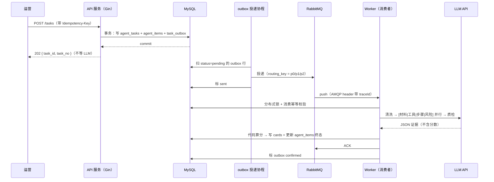
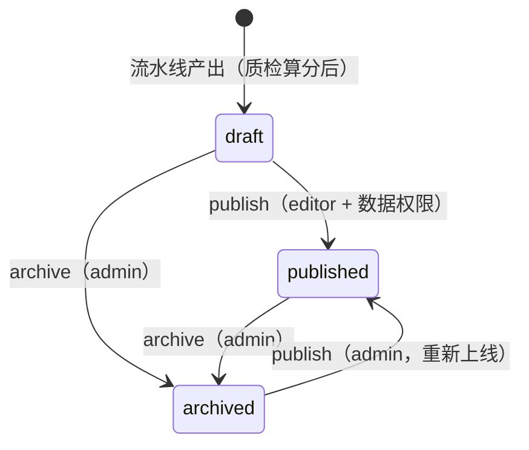

# 05 - 业务流程设计

> 本文档包含：多 Agent 流水线、Card Schema、异步任务链路、置信度设计、数据源与质量保障、合规、卡片生命周期状态机（5.7）。

---

## 5.1 多Agent流水线设计（平台核心亮点）

### 5.1.1 为什么用多 Agent 而不是单轮 LLM 一次性输出

| 痛点 | 单轮 LLM 一次性输出 | 多 Agent 流水线 |
| --- | --- | --- |
| 噪声干扰 | 广告闲聊混入抽取，结果被带偏 | 清洗 Agent 先净化文本，再交给下游 |
| 多实体互相干扰 | 材料/工具/步骤一起提，漏项错乱 | 任务解耦，各自独立 Agent |
| 步骤顺序错乱 | 长文步骤识别难，易颠倒 | 步骤 Agent 专职 + 质检时序校验 |
| 失败成本 | 任一环节出错整条重跑 | 子任务独立重试，只重跑失败环节 |
| 质量不可控 | 无校验机制 | 独立质检 Agent 输出证据，代码算分 |

### 5.1.2 Agent 角色定义（1 主 + 6 专项）

| Agent | 输入 | 输出 | 职责 | 是否必选 |
| --- | --- | --- | --- | --- |
| 主规划 Agent | 任务配置、原始教程文本 | 调度指令、汇总卡片 | 分片、调度、状态管理、结果汇总 | ✅ |
| 文本清洗 Agent | 原始教程文本 | 清洗后文本 + 被删片段记录 | 剥离广告、闲聊、冗余语句，标记 removed_spans | ✅ |
| 材料提取 Agent | 清洗后文本 | 材料清单 JSON | 提取材料、耗材、规格、用量 | ✅ |
| 工具提取 Agent | 清洗后文本 | 工具清单 JSON | 提取所需工具 | ✅ |
| 步骤拆解 Agent | 清洗后文本 | 有序步骤 JSON | 拆解分步操作，去冗余话术 | ✅ |
| 风险评估 Agent | 清洗后文本 | 难度等级 + 风险清单 | 评估难度（easy/medium/hard），识别安全风险 | ✅ |
| 质检 Agent | 卡片 JSON + 原文 | 证据清单（不直接给分） | 输出缺失字段、时序冲突对、不一致片段 | ✅ |

> **"主规划 Agent"由编排器代码实现，不调用 LLM**：它只做分片、调度、状态汇总与结果合并，不做语义判断。所以 `agent_configs` 只有 6 行、`agent_items.agent_name` 只有 6 个取值，单条教程的 LLM 调用次数是 **6 次**（11.3 的成本模型按 6 次算）。之所以还叫它 Agent，是因为它和其他 Agent 共用同一个 `Agent` 接口契约，而不是因为它有 Prompt——**这一点必须在面试里主动说清，否则"7 个 Agent"和"6 次调用"会被当成矛盾**。

### 5.1.3 流水线编排方式

- **默认串行**：清洗 → 材料/工具/步骤/风险（可并行）→ 质检；
- **失败隔离**：某 Agent 失败只重试该 Agent，前序结果保留；
- **可降级**：关闭任一 Agent（如风险评估），流水线仍可跑通，卡片缺字段并降置信度；
- **可插拔**：Agent 实现统一接口，新增 Agent（如难度校准）即插即用。

### 5.1.4 Agent 统一协议（伪代码）

```go
type Agent interface {
    Name() string
    Run(ctx context.Context, input AgentInput) (*AgentOutput, error)
}
// AgentInput: 上游 JSON + 原文引用 + 配置（Prompt模板/模型/温度）
// AgentOutput: 结果 JSON + 状态 + 错误信息 + 耗时 + token 消耗
```

> 面试话术：**每个 Agent 是一个独立可重试的单元，编排器只负责数据流转与状态管理，Agent 之间不直接对话、不自由聊天，所有信息经编排器中转——可控、可观测、可单独调优。**

### 5.1.5 清洗 Agent 的特殊设计（防信息不可逆丢失）

清洗 Agent **不物理删除**噪声，而是输出被删片段清单：

```json
{
  "cleaned_text": "清洗后的文本...",
  "removed_spans": [
    { "reason": "ad", "text": "点击链接购买同款..." },
    { "reason": "chat", "text": "我上次做这个失败了三次哈哈" }
  ],
  "kept_ratio": 0.78
}
```

> `reason` 是**英文枚举**（`ad` / `chat` / `meta` / `duplicate` / `broken`，取值与说明见 `prompts/clean.md`），前端按枚举查中文文案渲染。文档示例里不写中文，避免"库里存英文、示例写中文"的两套值。

> **LLM 不输出字符偏移。** 让模型数 `start/end` 是已知的不可靠行为（同一文本两次调用偏移不同），所以 `removed_spans` 里只有 `reason` + 原文句子。

**偏移由后端补，规则三步**（写在 `clean_agent.go` 里，不依赖模型）：

1. 在 `raw_text` 中做唯一子串查找（`strings.Index`）；
2. 命中且**全文唯一** → 补 `start/end`；命中多处或未命中 → 丢弃该 span，并记 `span_drop_total{reason="not_found"}` 指标；
3. 落库前自检 `raw_text[start:end] == text`，不等即视为无效，不写库；通过校验的 span 写入 `cards.removed_spans`（JSON），与卡片同版本存放——复核页要按卡片版本还原"当时删了什么"，不能读最新的清洗结果。

**下游行为**：所有 Agent 统一拿 `cleaned_text`，但质检与复核页面能按 `start/end` 高亮被删片段、一键展开原文——防止清洗阶段误删材料名导致不可逆信息丢失。

**降级路径（两个触发条件，命中任一即标记）**：① `kept_ratio < 0.5`——清洗后留存不足一半，判定过度清洗；② `span` 命中率 < 50%——`removed_spans` 中能在 `raw_text` 里唯一定位的比例过低，判定清洗输出与原文偏离过大。命中即标 `clean_degraded`、按 5.4.2 惩罚项扣 **0.10**、进人工复核，不静默通过。

> 此前本节只写条件②、`prompts/clean.md` 只写条件①——同一个 flag、同一个扣分，两个不同的触发量，实现时必然二选一。现统一为 **OR**，两处同口径。

***

## 5.2 卡片数据结构（Card Schema）

> 这是整个平台的核心数据结构，所有 Agent 的输入输出、质检规则、前端渲染、导出格式都基于此。

### 5.2.1 卡片完整 JSON Schema

```json
{
  "card_id": 10231,
  "tutorial_id": 5678,
  "card_version": 1,
  "materials": [
    {
      "name": "牛皮纸",
      "spec": "A4 120g",
      "qty": 2,
      "unit": "张",
      "optional": false,
      "evidence": "原文第3段：准备两张A4牛皮纸"
    }
  ],
  "tools": [
    {
      "name": "美工刀",
      "required": true,
      "spec": "",
      "evidence": "原文第5段：用美工刀沿虚线裁切"
    }
  ],
  "steps": [
    {
      "seq": 1,
      "action": "沿虚线裁切纸张",
      "uses": ["牛皮纸", "美工刀"],
      "duration_est": "5min",
      "warnings": []
    },
    {
      "seq": 2,
      "action": "折叠成型",
      "uses": ["裁切好的牛皮纸"],
      "duration_est": "10min",
      "warnings": []
    }
  ],
  "risks": [
    {
      "level": "high",
      "type": "cut",
      "desc": "使用美工刀裁切，注意手指",
      "mitigation": "垫切割垫、戴手套"
    }
  ],
  "difficulty": {
    "level": "easy",
    "reason": "步骤 5 步以内，无高温/明火"
  },
  "confidence": 0.86,
  "confidence_detail": {
    "completeness": 0.90,
    "temporal": 0.80,
    "grounding": 0.85,
    "quality": 0.95
  },
  "quality_flags": ["missing:tools", "ungrounded:砂纸"]
}
```

### 5.2.2 关键字段设计说明

| 设计点 | 说明 |
| --- | --- |
| 每个实体带 `evidence` | 原文片段引用，是"原文一致性"校验能落地的前提，也让"忠实抽取"这个卖点可验证 |
| `card_version` | 支持重跑（re_structurize），新版本不覆盖旧版本，`is_current=1` 标记当前版 |
| `steps[].uses` | 步骤与材料/工具的关联，支撑"这步用到什么"的追问。`uses` 由模型按**原文写法**输出，后端用同义词表做 `name_norm` 归一化后再与材料/工具清单比对——不要求模型在并行阶段就"对齐另一路 Agent 的输出"，否则四路并行不成立 |
| `difficulty` | 两个存储字段的**拼装视图**：`level` → `cards.difficulty`（枚举，供 `idx_difficulty` 筛选），`reason` → `cards.difficulty_reason`（可读理由，复核可改）。拆开存是因为"筛选要单列、展示要长文本"，一条都不丢 |
| `quality_flags` | 质检问题的**人读视图**，由打分函数一并产出（不额外调用 LLM）。**全部 6 种取值**（不在此表的 flag 视为非法，前端按前缀染色）：`missing:{field}` ← 质检 `missing_fields[]`，扣 completeness；`conflict:{seq_a}-{seq_b}` ← 质检 `step_conflicts[]`，扣 temporal；`ungrounded:{entity_name}` ← 质检 `grounding_issues[]`，不直接扣分（grounding 由代码按 evidence 命中率算）；`low_confidence` ← 总分 < 0.5（5.4.4 置顶档）；`risk_suspect` ← `risks` 为空但步骤含高温/明火/电钻/刀（`prompts/risk.md` 校验表）；`clean_degraded` ← 5.1.5 两个触发条件之一（惩罚 0.10）。**落库为 `cards.quality_flags`（JSON）** |
| `confidence_detail` | 四个维度的分项分数（键名固定为 `completeness` / `temporal` / `grounding` / `quality`，与 3.2 注释、Go struct 逐字一致），不只存总分，便于定位扣分原因。**落库为 `cards.confidence_detail`（JSON）**，`GET /cards/{id}` 直接返回，不重算 |

### 5.2.3 Go struct 定义（internal/model/card.go）

```go
type Card struct {
    ID            uint64    `gorm:"primaryKey"`
    TutorialID    uint64    `gorm:"not null;index"`
    TaskID        uint64    `gorm:"not null;index"`
    CardVersion   uint      `gorm:"not null;default:1"`
    IsCurrent     bool      `gorm:"not null;default:true"`
    MaterialsJSON JSON      `gorm:"type:json"`
    ToolsJSON     JSON      `gorm:"type:json"`
    StepsJSON     JSON      `gorm:"type:json"`
    RiskJSON      JSON      `gorm:"type:json"`
    Difficulty    string    `gorm:"size:16"`     // difficulty.level，供筛选
    DifficultyReason string `gorm:"size:255"`    // difficulty.reason，与 Difficulty 一起拼成 Card Schema 的 difficulty 对象
    Confidence    float64   `gorm:"type:decimal(4,3)"`
    // 以下三列必须有对应字段，否则 5.2.2 承诺的"能存、能返回"落不了地（表定义见 3.2）
    ConfidenceDetail JSON   `gorm:"type:json"` // {completeness, temporal, grounding, quality}
    QualityFlags     JSON   `gorm:"type:json"` // ["conflict:2-4", "ungrounded:电钻"]
    RemovedSpans     JSON   `gorm:"type:json"` // [{reason: "ad", text: "...", start: 120, end: 148}]
    Status        string    `gorm:"size:16;default:draft"`       // draft/published/archived
    ReviewStatus  string    `gorm:"size:20;default:auto_passed"` // auto_passed/pending_review/reviewed/rejected
    ReviewedBy    *uint64
    ReviewedAt    *time.Time
    CreatedAt     time.Time
    UpdatedAt     time.Time
    DeletedAt     gorm.DeletedAt `gorm:"index"` // 与 3.2 的 deleted_at 对应，查询自动过滤
    // CurrentTutorialID 是数据库生成列（3.4.3），只读；Go 侧声明为 -:migration 防止被写入
    CurrentTutorialID sql.NullInt64 `gorm:"->;-:migration"`
}

type MaterialItem struct {
    Name     string  `json:"name"`
    Spec     string  `json:"spec,omitempty"`
    Qty      float64 `json:"qty,omitempty"`
    Unit     string  `json:"unit,omitempty"`
    Optional bool    `json:"optional"`
    Evidence string  `json:"evidence"`
}

type ToolItem struct {
    Name     string `json:"name"`
    Required bool   `json:"required"`
    Spec     string `json:"spec,omitempty"` // 与 card_entities.spec、tool Prompt 的输出字段一致
    Evidence string `json:"evidence"`
}

type StepItem struct {
    Seq          int      `json:"seq"`
    Action       string   `json:"action"`
    Uses         []string `json:"uses,omitempty"`
    DurationEst  string   `json:"duration_est,omitempty"`
    Warnings     []string `json:"warnings,omitempty"`
}

type RiskItem struct {
    Level      string `json:"level"` // high/medium/low
    Type       string `json:"type"`  // cut/burn/electricity...
    Desc       string `json:"desc"`
    Mitigation string `json:"mitigation"`
}
```

***

## 5.3 异步任务链路详解（平台核心亮点）

### 5.3.1 为什么必须异步

- 单条教程 LLM 拆解耗时 3~15 秒；批量导入可能几百上千条；
- 同步处理会导致 HTTP 长时间占用、超时、阻塞其他请求。

**结论：导入接口秒回"任务已提交"，真正处理在后台消费者里跑。**

### 5.3.2 状态机与关键机制

> 机制细节（阈值、幂等键粒度、死信配置、并发数）的**唯一权威在 06**，本节不复述，避免两处漂移。

- 任务状态：`pending → running → succeeded / failed → dead`；
- 子任务独立：`agent_items` 中"每条教程 × 每个 Agent"各有终态，失败只重试该行；
- 六个机制：客户端幂等键 → outbox 投递补偿 → 消费幂等标记 → 分布式锁 → 指数退避重试 → DLX 死信。

### 5.3.3 一条完整链路（30 秒口述版）

> ①运营带 `Idempotency-Key` 提交任务 → ②同一事务写 `agent_tasks` + `agent_items` + `task_outbox`，接口 `202` 秒回 → ③投递协程扫 outbox 投 MQ，投成功标 `sent`、消费 ACK 后标 `confirmed`，另有 5min 兜底重投 → ④消费者加锁 + 幂等校验，从 AMQP header 恢复 traceId → ⑤跑流水线：清洗 → 材料/工具/步骤/风险 → 质检 → ⑥质检出证据、代码算分，≥0.8 直接入库，否则进复核队列 → ⑦子任务失败只重跑该行，超限进死信。
>
> 一句话总结：**幂等键防重复提交 → outbox 保投递不丢 → 队列削峰 → 锁 + 消费幂等保唯一 → 子任务独立成败 → 失败进死信 → 置信度分流人机协同。**

### 5.3.4 异步链路时序图



> 图中没有 API Gateway / 负载均衡：**单机 compose 部署，API 前面不挂反代**（8.2.1 与 11.1 的 A2 都按这个前提写）。前端容器内的 nginx 只做静态服务与 `/api` 同源转发，不参与健康摘流，两者不要混为一谈（见 9.12）。

***

## 5.4 LLM 结构化输出容错与置信度设计

### 5.4.1 结构化输出容错（三层兜底）

1. **Prompt 强制约束**：每个 Agent 的 Prompt 指定 JSON Schema 与字段枚举，要求仅输出 JSON；
2. **解析异常捕获**：后端捕获 JSON 解析失败，按 6.2 的重试协议自动重试（次数上限 = `LLM_MAX_RETRY`，默认 3，见 9.2；解析失败与调用超时共用同一套退避与死信路径，不另设一套计数），仍失败则标记为低置信/失败；
3. **质检校验**：质检 Agent 校验 JSON 结构、字段合法性、枚举值，异常样本进入人工复核。

### 5.4.2 置信度打分：LLM 出证据，代码算分

> **核心原则**：LLM 不直接输出 0~1 的分数（已知不可靠），而是输出结构化证据，由程序按权重计算置信度。

| 维度 | 权重 | 计算式（全部由代码执行） | 证据来源 |
| --- | --- | --- | --- |
| 字段完整性 | 0.40 | `completeness = max(0, 1 − 0.25 × count(missing_fields))` | 质检 Agent 的 `missing_fields` |
| 步骤时序合理性 | 0.25 | `temporal = max(0, 1 − 0.20 × count(step_conflicts))` | 质检 Agent 的 `step_conflicts` |
| 原文一致性 | 0.25 | `grounding = hit_entities / total_entities`（`total=0` 时取 1.0） | 代码在 `raw_text` 中匹配每个实体的 `evidence` |
| 文本质量 | 0.10 | `quality = 0.4×长度达标 + 0.3×(1−噪声符号占比) + 0.3×(1−非教程句比例)` | 纯规则，无 LLM |

```
confidence = clamp(0, 1)( 0.40×completeness + 0.25×temporal + 0.25×grounding + 0.10×quality − Σ penalties )
           → 保留 3 位小数
```

**`quality` 维度三个子项的判定口径**（此前只有公式没有口径，两个人会实现出两个分数）：

| 子项 | 系数 | 判定规则（全部为 `scorer.go` 的代码常量） |
| --- | --- | --- |
| 长度达标 | 0.4 | `clamp(cleaned_text 字数 / 800, 0, 1)`；800 字取 5.5.3 长度上限 3000 的约 1/4，作为"信息量足够"的下限 |
| 噪声符号占比 | 0.3 | `1 − 噪声字符数 / 总字符数`；噪声字符 = 正则 `[!?~★☆…【】]` 与 emoji 中**连续 ≥ 3 个**的片段（常量 `noiseSymbolRe`） |
| 非教程句比例 | 0.3 | `1 − 非教程句数 / 总句数`；句子按 `[。！？!?\n]` 切分；非教程句 = 既不以动词/祈使开头，也不含数量单位、时间、温度、尺寸词（词表复用 5.5.3 的领域词表） |

**惩罚项 `penalties`**（四维加权之外的扣分；此前 prompts 里三处"降置信度"在公式中没有落点）：

| 触发条件 | 常量 | 出处 |
| --- | --- | --- |
| `clean_degraded`（5.1.5 两个触发条件之一） | 0.10（每条一次，不叠加） | `prompts/clean.md` 校验表 |
| `difficulty.reason` 为空 | 0.05 | `prompts/risk.md` 校验表 |
| `action` 超 40 字被丢弃 | 0.05 × 丢弃条数，上限 0.15 | `prompts/step.md` 校验表 |

**四条硬规则**（否则分数不可复现）：
1. 每个维度先 `clamp(0,1)` 再加权，**缺 4 项即该维度归零**，不会出现负分；
2. 权重与惩罚项常量都在 `internal/quality/scorer.go`，**不在环境变量里**，避免不同环境分数不同；
3. 只有阈值 `0.8` 走 env（`QUALITY_CONFIDENCE_THRESHOLD`），改阈值不改分数；
4. `confidence_detail` **仍只存四维分项、不加第五个键**：总分与四维加权的差值即 `Σ penalties`，触发原因在 `quality_flags` 里可读（5.2.2）——这样"分数怎么来的"始终可解释，也不需要改 3.2 的列注释与 Go struct。

**算例**（可用来做单测断言）：`missing_fields=2`、`step_conflicts=1`、`grounding=17/20`、`quality=0.95`

```
completeness = 1 − 0.25×2 = 0.50
temporal     = 1 − 0.20×1 = 0.80
grounding    = 17/20      = 0.85
quality                     = 0.95
confidence = 0.40×0.50 + 0.25×0.80 + 0.25×0.85 + 0.10×0.95
           = 0.20 + 0.20 + 0.2125 + 0.095 = 0.7075 → 0.708  → < 0.8，进人工复核

# 若该条同时命中 clean_degraded（惩罚 0.10）：
confidence = 0.708 − 0.10 = 0.608 → 仍是 pending_review，quality_flags 多一个 clean_degraded
```

**为什么不让 LLM 直接给分？**
- 同一份输入两次调用，LLM 可能给 0.82 和 0.61，阈值半分流完全失效；
- LLM 自评自证（"我觉得我抽得不错"）没有校准依据；
- 代码算分可复现、可调试、可回归——改了 Prompt 后跑同一批样本，分数变化可量化。

### 5.4.3 阈值标定方法（方法已定稿，尚未执行）

> **口径**：`0.8` 目前是**设计值**，不是标定结果（`11.2` 的 R5 仍为 TBD，`10.11` 已把它列为已知缺陷）。

- **标定方法**：在 200 条人工标注样本上画"阈值-准确率/precision"曲线（即阈值为横轴、该阈值下自动通过子集的字段准确率为纵轴），取 precision ≥ 0.9 的最低阈值作为分流线；
- 标注样本分层覆盖：高质量教程 / 中等噪声教程 / 低质残缺教程，各占 1/3；
- **执行与登记**：跑完后把"阈值 + precision + 样本集版本 + 日期"写进 11.2 的 R5 行；未登记前，对外只说"设计值待标定"，不说"已按曲线取的最优阈值"。

### 5.4.4 分流策略

| 置信度区间 | `review_status` | 队列表现 | 复核员动作 |
| --- | --- | --- | --- |
| `≥ 0.8` | `auto_passed` | 不入队 | 无需动作（可抽查） |
| `0.5 ≤ c < 0.8` | `pending_review` | 常规档，标黄 | 修改后 `approved`/`modified`，或 `rejected` |
| `c < 0.5` | `pending_review` + `quality_flags` 含 `low_confidence` | **置顶档，标红**，默认提示"疑似质检失败，建议重跑" | 先看 `confidence_detail` 判断是重跑还是手改 |

**为什么 `< 0.5` 不写 `rejected`**：`GET /review-queue` 只捞 `pending_review`（见 4.2），一旦自动写成 `rejected`，这批卡片既不在队列里、也不算正常入库，**没有任何界面能捞到它们**；而且 `rejected` 已被 4.3.4 用来表示"人工拒绝"，两种语义共用一个枚举值会让 Q5（复核修改率）的分母无法界定。所以：**自动分流只产出 `auto_passed` / `pending_review` 两种状态，`rejected` 只由人工显式拒绝写入。**

### 5.4.5 人工复核闭环

- 前端展示原文 + 拆解结果对照，复核员可修改字段、标注原因；
- **队列两档排序**：`confidence < 0.5` 置顶（疑似质检失败）、`0.5~0.8` 常规；同一档内按 `confidence` 升序，先看最差的；
- 清洗 Agent 删除的 `removed_spans` 可一键展开，复核员确认是否误删；
- 修改记录写入 review_logs（前后对比留痕）；
- 回流样本可导出，用于后续 Prompt 调优与效果评估。

***

## 5.5 数据源与数据质量保障

### 5.5.1 数据集选型（具体、可溯源）

| 数据集 | dataset_id | 规模 | 语言 | License | 说明 |
| --- | --- | --- | --- | --- | --- |
| WikiHow DIY 子集 | `wikihow`（精选 DIY/craft 分类） | ~500 条（采样） | 英文 | CC BY-NC-SA | 结构化程度高，带步骤分解 |
| Instructables 归档 | 公开归档子集 | ~300 条（采样） | 英文 | 非商业研究用途 | 真实 UGC 风格，噪声多 |
| 自建中文种子集 | 人工标注 | ~200 条 | 中文 | 自有 | 覆盖木工/布艺/折纸/手工模型，标注规范见下 |

> **为什么不只靠公开数据集？** HuggingFace 上 DIY 教程基本是英文，而你面向的是中文场景。纯英文数据集跑出来的效果在面试时说服力不够（"这是英文教程拆解"），所以自建 200 条中文种子集作为主要评测集，英文公开集作为补充和对比。

**标注规范（中文种子集）**：
- 每条教程人工标注材料清单、工具清单、有序步骤、难度、风险点；
- 标注 2 人交叉校验，不一致处第三人仲裁；
- 分层：高质量（结构清晰）/ 中噪声（夹带闲聊）/ 低质（残缺广告多）各约 1/3。

### 5.5.2 语言策略

- **方案：抽取时直接输出中文**。英文原文 → 一次 LLM 调用内完成"理解 + 抽取 + 输出中文卡片"，不单独做翻译步骤；
- **为什么不先翻译再抽取？** 多一次调用多一次失真，且成本翻倍；一次调用内直接输出中文是更优解；
- **注意**：英文样本的 `evidence` 字段保留原文片段，方便溯源核对。

### 5.5.3 离线预处理（导入系统前一次性执行）

1. **长度过滤**：过滤过短（<50 字符）与过长（>3000 字符）文本，防 token 爆炸；
2. **语言无关粗筛**（不依赖中文关键词）：
   - 标题层级数量（有步骤小标题/编号列表 → 大概率是教程）；
   - 列表符号密度（`1.` `2.` `-` `*` 开头的行占比）；
   - 祈使句/动词开头句比例（"Cut..." "Fold..." "准备..."）；
   - 领域词表（中英双语）：cut/fold/glue/saw/木工/折叠/胶水/切割...
3. **哈希去重**：全文哈希剔除完全重复教程；
4. **分层抽样**：高质量集（Demo 演示）/ 普通集（功能测试）/ 坏样本集（广告多、残缺教程，测异常兜底）。

### 5.5.4 系统在线校验（Go 后端）

1. 导入校验：文本非空、长度阈值，超限直接拒绝进入流水线（不消耗 token）；
2. 清洗 Agent 剥离广告冗余；
3. 质检 Agent 校验材料/工具/步骤同时存在，缺失即降置信度。

### 5.5.5 "真实且大而全"的保障思路（面试重点）

- **真实**：来源是社区真实用户发布的教程原文（非 AI 合成），带原始链接可溯源；抽样核对确认未被篡改；
- **大而全**：多源合并 + 多样性采样（覆盖多种手工类型、多难度、多文本风格），分层抽样与版本管理；
- **边界**：DIY 教程是网友经验，不代表操作一定正确安全。平台定位是忠实结构化提取原文内容，**不校验教程实操可行性**，质检只校验抽取结果与原文一致。

***

## 5.6 数据合规与许可边界

> 这一节回答"你这些教程哪来的、能不能商用"。不做说明，等于把风险留给面试官想象。

### 5.6.1 三类数据源的许可与用途

| 数据源 | 许可 | 能否入库 | 能否导出/商用 | 约束 |
| --- | --- | --- | --- | --- |
| WikiHow DIY 子集 | CC BY-NC-SA 4.0 | 仅评测环境 | **否** | NC=禁止商业使用；SA=衍生作品需同协议开放；BY=必须署名 |
| Instructables 归档 | 非商业研究用途 | 仅评测环境 | **否** | 不得再分发原文；不得用于产品 |
| 自建中文种子集 | 自有（作者授权/平台自有） | 是 | 是 | 需保留来源链接与作者署名 |

**一句话规则**：**公开集只用于离线评测（跑完即删原文、只留指标），生产卡片库只装自建集。**

### 5.6.2 落库与导出时的合规字段

1. `tutorial_sets.license` 必填（`CC-BY-NC-SA-4.0` / `research-only` / `self-owned`），建集接口校验枚举；
2. `GET /cards` 与导出文件默认**只返回 `self-owned` 集**的卡片；带 `include_eval=true` 时需 admin 且响应头标注 `X-Eval-Only: true`；
3. 导出 JSON/CSV 每行带 `source_url` + `license`，满足署名与追溯要求。

### 5.6.3 隐私与删除

- 原文中的作者昵称、联系方式在入库前由预处理脚本脱敏（正则 + 人工抽检）；
- 收到原作者删除请求时，按 `tutorial_sets → tutorials → cards` 级联软删，并在 `operation_logs` 记 `data:takedown`；
- 日志中禁止打印原文全文（只允许打印 `tutorial_id` 与长度），避免审计日志成为第二个泄露面。

### 5.6.4 合规自检清单（发版前）

- [ ] 生产库中不存在 `license != self-owned` 的卡片（下面这条 SQL 返回 0 即通过；`license` 在 3.2 已是 `NOT NULL DEFAULT 'research-only'`，`<>` 比较不会因 NULL 漏判）

```sql
SELECT COUNT(*) AS violations
FROM cards c
JOIN tutorials t     ON t.id = c.tutorial_id AND t.deleted_at IS NULL
JOIN tutorial_sets s ON s.id = t.set_id     AND s.deleted_at IS NULL
WHERE s.license <> 'self-owned' AND c.deleted_at IS NULL;   -- 期望 0
```

- [ ] 导出接口默认过滤 + 权限校验生效
- [ ] 预处理脚本的脱敏规则对 20 条样本抽检通过
- [ ] README 与项目介绍中未宣称"可用于商用"（避免与 NC 数据源冲突）

***

## 5.7 卡片生命周期状态机（`cards.status`）

> 1.1 只定义枚举值，**流转规则以本节为唯一权威**。流水线只产 `draft`；`published` / `archived` 必须由人工动作写入（4.2 #26/#27），否则这两个状态就是没有入边的僵尸态。



| 当前态 | 动作 | 目标态 | 执行者 | 审计动作（7.4.1） |
| --- | --- | --- | --- | --- |
| `draft` | `POST /cards/{id}/publish` | `published` | editor + 数据权限 | `card:publish` |
| `draft` | `POST /cards/{id}/archive` | `archived` | admin | `card:archive` |
| `published` | `POST /cards/{id}/archive` | `archived` | admin | `card:archive` |
| `archived` | `POST /cards/{id}/publish` | `published` | admin（重新上线） | `card:publish` |

四条约束：

1. **每个状态都有入边与出边**：`draft` 由流水线写入，`published` / `archived` 只能由上表两个人工动作写入，写入者、执行角色、审计动作三者一一对应；
2. `archived` 卡片**不可编辑**：`PUT /cards/{id}` 返回 `40902`（4.8.2），要先 `publish` 回到可编辑态；
3. `status`（生命周期）与 `review_status`（复核态）**正交**：`pending_review` 的卡片同样处于 `draft`；复核通过 ≠ 发布，两个状态各自独立流转；
4. **合规下架不是 `archived`**：5.6.3 的 `data:takedown` 走级联软删（`deleted_at`，对外不可见），`archived` 是"内容仍可查但不再维护"，两者语义与审计动作都不同，不可混用。

> 发布时间不新增列：以 `operation_logs`（`action=card:publish`）的 `created_at` 为准，避免 `cards` 再长一个只有一个写入方的字段。

***
